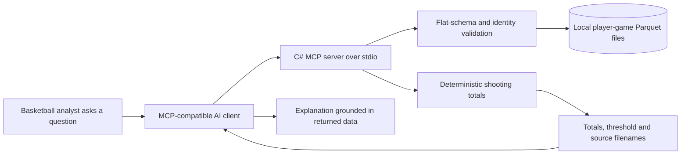

# Basketball Parquet MCP

**From a general Parquet MCP server to natural-language basketball analysis for an NBA team use case.**

This is the basketball follow-up to my original [C# Parquet MCP server](https://github.com/atonyhonesto/ParquetMCPServer). I used historical NBA playoff data to explore how an AI assistant could discover local datasets, inspect their schemas and answer player-focused questions through MCP tool calls. The proof of concept was shared in an NBA-team discussion.

The interesting step was moving from **"the assistant can read a file"** to **"the assistant can work across games and explain an analytical answer with verifiable totals."** A question such as "Who had the best free-throw percentage on high volume?" requires a definition of volume, coverage of the full series, and a weighted calculation across games.

This public edition reconstructs that workflow with a small .NET 10 MCP server, fictional players and generated Parquet files. It includes new validation, deterministic shooting aggregation, tests and CI added for the portfolio release. It is an independent proof of concept; it does not represent NBA or team endorsement, commissioning, deployment or access to internal systems.

[](https://github.com/atonyhonesto/basketball-parquet-mcp/actions/workflows/ci.yml)


## Run the example

Requires the .NET 10 SDK. No database server, Python runtime or API key is needed for the deterministic demo.

```bash
dotnet restore BasketballMcp.sln
dotnet build BasketballMcp.sln -c Release -warnaserror
dotnet test BasketballMcp.sln -c Release
dotnet run --project src/BasketballMcp -c Release -- --seed-sample
dotnet run --project src/BasketballMcp -c Release -- --demo
```

The seed command writes three files under `data/synthetic`. It refuses to overwrite existing sample files. The demo ranks free-throw shooting over all three games. Morgan Lane has **19 makes on 22 attempts, 86.36%**, with a minimum of ten series attempts. These are fictional values, not NBA statistics. Averaging Morgan's individual game percentages would produce a different, incorrect series percentage.

Set `BASKETBALL_DATA_DIR` to use another dedicated, trusted directory. The server reads top-level `.parquet` files only; do not point it at an unrelated mixed-schema data folder.

## How it works



The server performs data access and the implemented shooting calculation. The AI client plans tool calls and explains results. A model's explanation still needs to be checked against returned rows, coverage and arithmetic.

| Tool | Purpose |
|---|---|
| `ListDatasets` | Discover the local game files |
| `GetSchema` | Inspect the explicit player-per-game contract |
| `QueryPlayerGames` | Retrieve bounded pages across validated files, with total row coverage |
| `RankFreeThrowShooters` | Compute `100 × SUM(made) / SUM(attempted)` and apply a series-total attempt threshold |

Other questions are documented in the [30-question catalogue](docs/basketball-questions.md). That catalogue is an exploration agenda, not a claim that every metric has a dedicated tool or validated answer.

## Connect an AI client

Publish the server first:

```bash
dotnet publish src/BasketballMcp -c Release -o artifacts/server
```

Use this MCP configuration with absolute paths appropriate to your machine:

```json
{
  "mcpServers": {
    "basketball-parquet": {
      "command": "dotnet",
      "args": ["/absolute/path/artifacts/server/BasketballMcp.dll"],
      "env": { "BASKETBALL_DATA_DIR": "/absolute/path/data/synthetic" }
    }
  }
}
```

On Windows, use escaped backslashes or forward slashes in JSON paths. Server logs go to stderr; stdout is reserved for MCP messages. Client setup varies by product. An AI client's subscription and data-handling rules still apply: the files remain local, but tool results can be sent to the model provider by a cloud-hosted client. Local storage does not imply fully offline AI inference.

Try: **"List the available files and schema, then rank free-throw shooters with at least 10 series attempts. Show makes, attempts, games and the formula. State that these are synthetic players."**

## What changed from the original effort

- **Original foundation:** C#/.NET MCP hosting, Parquet discovery, schema inspection and row retrieval.
- **Basketball follow-up:** historical playoff analysis, multi-game questions and a player-focused query catalogue, illustrated by the free-throw question.
- **Public reconstruction:** a flat normalized schema, generated fictional data, bounded paging, duplicate rejection, deterministic weighted percentages and automated tests. This is not presented as an exact archive of the historical runtime or its data.

See [project context and architecture decisions](docs/project-context.md) for scope, data handling and limitations.

## Data and operating limits

No original NBA Parquet files, private communications, recipient identities, email screenshots, team logos or historical model answers are redistributed. Bring data only if you have permission to use it. Real nested box-score data requires an explicit transformation to this repository's flat `PlayerGame` schema; the server rejects other schemas rather than silently combining arrays with different grains.

This is a local stdio demonstration, with no HTTP endpoint, multi-user identity or production isolation. It accepts no path, raw SQL or expression from a tool call. Data files must be trusted and stable while queries run. The file/row limits are safeguards for a small demo, not a hardened boundary against malicious compressed files or concurrent filesystem changes.

This project analyzes box-score facts. It does not claim to infer causal player impact, evaluate biomechanics or identify clutch performance from box scores alone.
